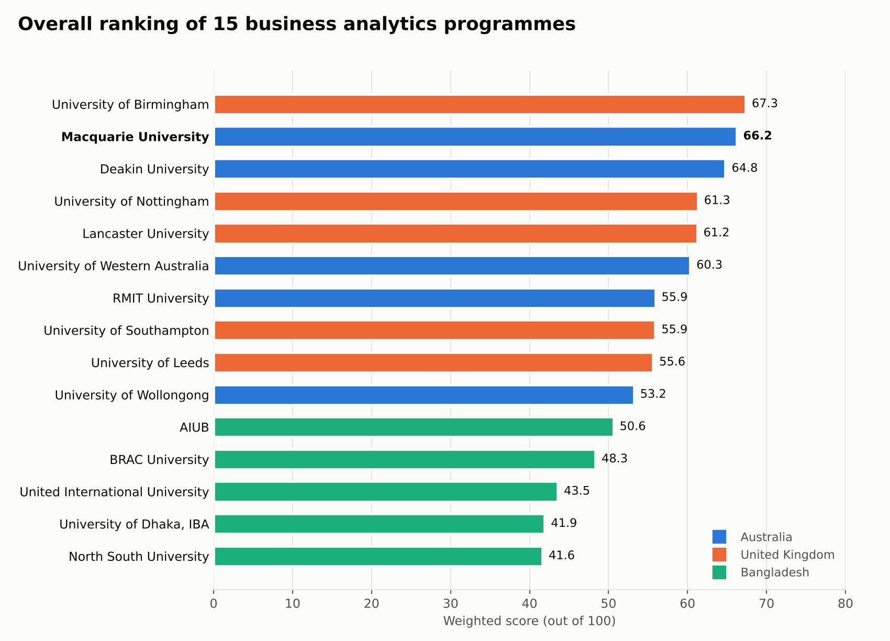
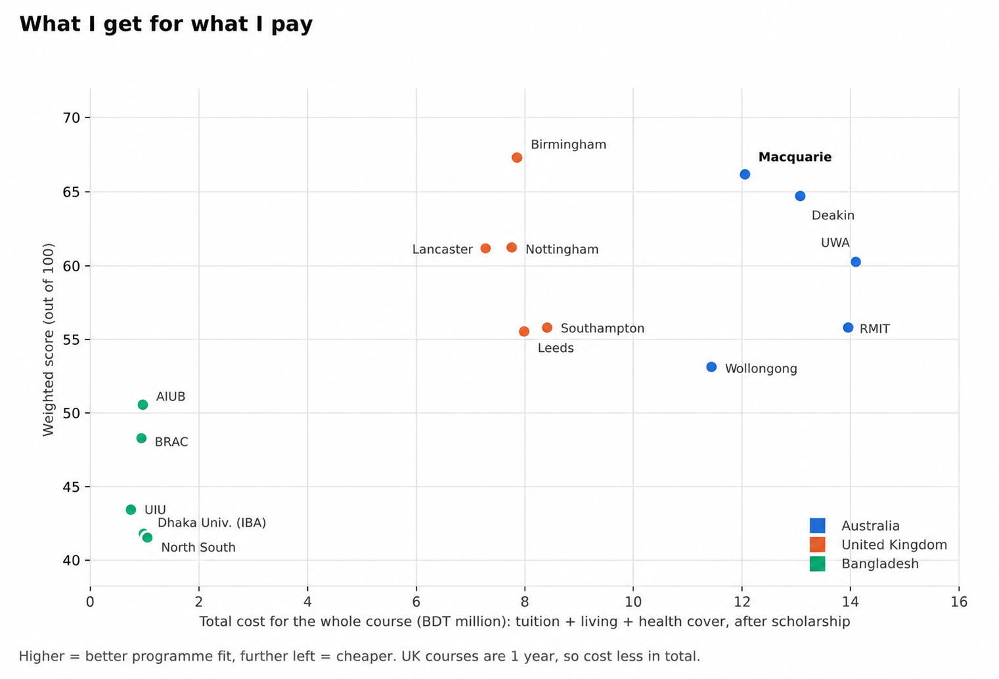
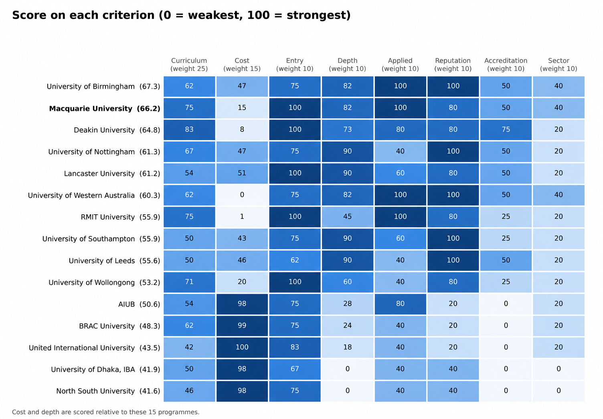
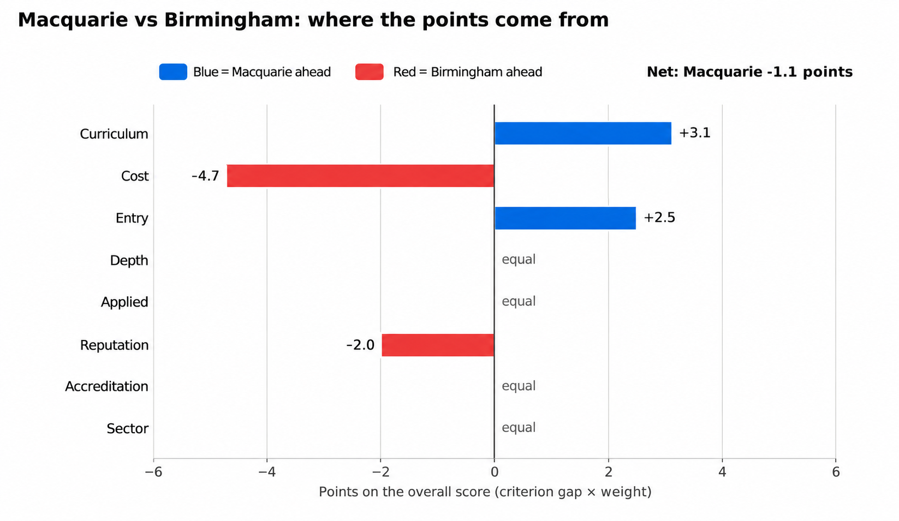

# Which business analytics master's suits me best?

**A comparison of 15 programmes in Australia, the United Kingdom and Bangladesh**
Shahriar Mazid · October 2026

Before choosing where to study, I wanted my decision to rest on evidence, not reputation alone. I compared 15 business analytics master's programmes, five in each country, and scored each one on eight weighted criteria. Macquarie University ranked **1st in Australia and 2nd overall (66.2 out of 100)**, 1.1 points behind the University of Birmingham.

## The question

Which programme gives the best return for me: a BBA (Management) graduate from Bangladesh with little programming experience, who plans to apply analytics to demand forecasting, fraud detection and solar expansion in the energy sector?

## The programmes I compared

| Country | University | Programme | Years |
|---|---|---|---|
| Australia | Macquarie University | Master of Business Analytics | 2 |
| Australia | Deakin University | Master of Business Analytics | 2 |
| Australia | University of Western Australia | Master of Business Analytics | 2 |
| Australia | RMIT University | Master of Business Analytics and AI Strategy | 2 |
| Australia | University of Wollongong | Master of Business Analytics | 1.5 |
| United Kingdom | University of Birmingham | MSc Business Analytics | 1 |
| United Kingdom | University of Nottingham | MSc Business Analytics | 1 |
| United Kingdom | Lancaster University | MSc Business Analytics | 1 |
| United Kingdom | University of Southampton | MSc Business Analytics and Management Science | 1 |
| United Kingdom | University of Leeds | MSc Business Analytics and Decision Sciences | 1 |
| Bangladesh | AIUB | MBA, Business Analytics specialisation | 2 |
| Bangladesh | BRAC University | MBA, Business Analytics major | 1.5 |
| Bangladesh | United International University | MBA, Business Analytics | 1 |
| Bangladesh | University of Dhaka, IBA | MBA (analytics coursework) | 2 |
| Bangladesh | North South University | MBA (analytics coursework) | 2 |

None of the five Bangladeshi universities offers a standalone Master of Business Analytics. They teach business analytics as a concentration or elective track within the MBA, so I included them as the closest domestic alternatives.

## How I scored them

I scored each programme from 0 to 100 on eight criteria, then combined the scores using the weights below.

| Criterion | Weight | What I measured |
|---|---|---|
| Curriculum | 25 | How many of 12 target skill areas the units cover (elective-only skills count half) |
| Cost | 15 | Total cost of the whole course; cheapest = 100, most expensive = 0 |
| Entry | 10 | Share of the entry requirements I meet with my BBA |
| Depth | 10 | Analytics units per month of study, plus 10 for foundation units |
| Applied work | 10 | Capstone (2 points), internship (2), industry project (1), out of 5 |
| Reputation | 10 | QS World University Rankings band |
| Accreditation | 10 | 25 points each for AACSB, EQUIS, AMBA and ACS |
| Sector relevance | 10 | 20 points per link to energy, IoT, fraud or fintech |

The 12 skill areas are: forecasting, programming, data science, predictive analytics, big data, visualisation, AI, cyber security and governance, project and change management, business information systems, capstone work, and payments or fintech.

**Total cost** = tuition + (living costs + health cover) × years of study − scholarship, converted to BDT. I did not count visa fees.

- Australia: AUD 29,710 a year for living costs and health cover (OSHC) together
- United Kingdom: GBP 14,052 a year for living costs, plus the GBP 776 a year Immigration Health Surcharge
- Bangladesh: my estimate of BDT 300,000 a year for living costs in Dhaka
- Exchange rates (14 Oct 2026): AUD 1 = BDT 86.57; GBP 1 = BDT 162.20
- My AUD 20,000 Macquarie scholarship is deducted, so Macquarie's tuition falls from AUD 99,800 to AUD 79,800

## Results

| Rank | University | Country | Score (out of 100) | Total cost (BDT million) |
|---|---|---|---|---|
| 1 | University of Birmingham | UK | 67.3 | 7.86 |
| 2 | **Macquarie University** | **Australia** | **66.2** | **12.05** |
| 3 | Deakin University | Australia | 64.8 | 13.07 |
| 4 | University of Nottingham | UK | 61.3 | 7.76 |
| 5 | Lancaster University | UK | 61.2 | 7.27 |
| 6 | University of Western Australia | Australia | 60.3 | 14.10 |
| 7 | RMIT University | Australia | 55.9 | 13.95 |
| 8 | University of Southampton | UK | 55.9 | 8.41 |
| 9 | University of Leeds | UK | 55.6 | 7.98 |
| 10 | University of Wollongong | Australia | 53.2 | 11.43 |
| 11 | AIUB | Bangladesh | 50.6 | 0.96 |
| 12 | BRAC University | Bangladesh | 48.3 | 0.93 |
| 13 | United International University | Bangladesh | 43.5 | 0.75 |
| 14 | University of Dhaka, IBA | Bangladesh | 41.9 | 0.98 |
| 15 | North South University | Bangladesh | 41.6 | 1.05 |

### Cost against score

UK programmes cost less in total because they last one year. Bangladeshi programmes are the cheapest but score lowest. Among the two-year programmes, Macquarie scores highest and costs less than Deakin, RMIT and UWA.

### Score on each criterion

### Why Birmingham is 1.1 points ahead of Macquarie

Birmingham gains on cost and reputation. Macquarie gains on curriculum and entry fit for a management graduate. The two are equal on depth, applied work, accreditation and sector relevance.

## My conclusion

I chose Macquarie University's Master of Business Analytics.

- **The top two are effectively tied.** A gap of 1.1 points out of 100 is smaller than the judgement involved in scoring curriculum from unit titles.
- **Birmingham's lead comes from cost and reputation, not fit.** Its lower cost is mostly the result of a one-year course.
- **Macquarie scores higher on what matters for my goals.** It covers more of the skills I need, and I meet all of its entry requirements.
- **The two-year structure suits my background.** Its Foundation Zone teaches statistics, programming and data science before advanced units in predictive analytics and big data. A one-year course assumes I already have that base.
- **It fits my plan.** I will study for two years, gain up to two years of work experience, then return to Modern Energy in Bangladesh to apply analytics to demand forecasting, prepaid-meter fraud detection and solar product expansion.

## Limitations

- Fees change every year. The tuition figures are my own research from October 2026; Wollongong's comes from my offer letter.
- I judged curriculum coverage from unit titles, not full unit guides. For Wollongong, Nottingham and North South University, I could not find full unit lists, so their curriculum figures are my estimates.
- I took some data from third-party sites such as Mastersportal where official pages did not publish it.
- Cost and depth are scored relative to these 15 programmes, so adding or removing a programme changes the scores.
- I did not score post-study work rights.

## Files

| File | What it contains |
|---|---|
| `BA-Programme-Comparison.xlsx` | The full workbook: data, sources, scoring formulas and dashboard. Download it to open in Excel. |
| `1-overall-ranking.png` | Overall ranking of the 15 programmes |
| `2-cost-vs-score.png` | Total cost against score |
| `3-criteria-heatmap.png` | Score on each criterion |
| `4-macquarie-vs-birmingham.png` | Where Macquarie and Birmingham gain and lose points |

The workbook updates automatically: change the weights, exchange rates or living costs on the Settings tab and all scores and rankings recalculate.
